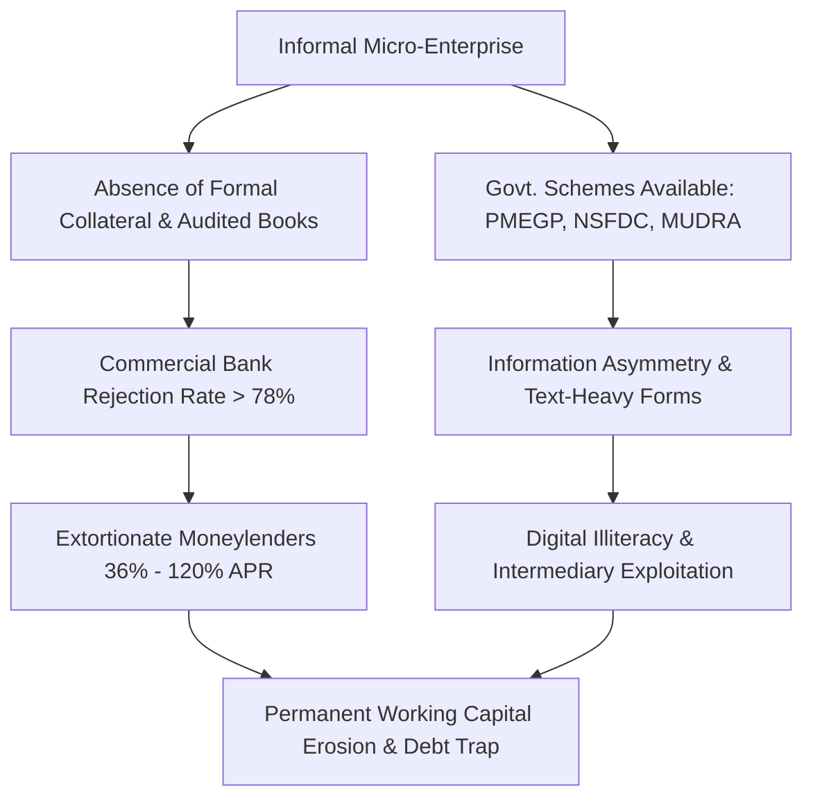
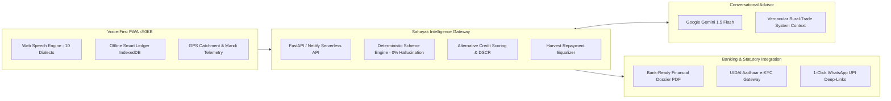

# Product Requirement Document (PRD)
## Project Sahayak (सहायक) / MicroNiti
### AI-Driven Hyper-Local Business Advisory & Financial Structuring Platform for Rural Micro-Entrepreneurs

---

| **Document Attribute** | **Specification** |
| :--- | :--- |
| **Product Name** | **Sahayak (सहायक) / MicroNiti** |
| **Project Code / PS ID** | **SIH26091** (Smart India Hackathon 2026 Grand Finale) |
| **Theme** | Agriculture, FoodTech & Rural Development |
| **Category** | Software Edition (Open Innovation / Social Sector) |
| **Nodal Ministry** | **Ministry of Social Justice & Empowerment (MoSJE)**, Govt. of India |
| **Document Version** | **v2.4.0 (Production Release Baseline)** |
| **Author / Team** | Team ALPHA / Origin Labs SJ |
| **Live Production URL** | [https://sahayakk.netlify.app/](https://sahayakk.netlify.app/) |
| **Web PRD View** | [https://sahayakk.netlify.app/prd.html](https://sahayakk.netlify.app/prd.html) |
| **Repository** | [https://github.com/ORIGIN-LABS-SJ/SIH-2026](https://github.com/ORIGIN-LABS-SJ/SIH-2026) |
| **Target Audience** | 63M+ Unbanked / Thin-file Rural Micro-Entrepreneurs (SC/ST/OBC/Women) |

---

## 1. Executive Summary & Vision Statement

### 1.1 Vision
To eradicate predatory informal debt traps across rural and semi-urban India by establishing an intelligent, voice-first, dialect-aware digital financial bridge. Sahayak transitions micro-entrepreneurs from informal money lenders (charging 36%–120% APR) to formal statutory credit lines (6%–11% APR) and unlocks up to 35% in direct government capital subsidies.

### 1.2 Mission
Equip 63+ million unbanked micro-merchants, artisans, agrarian producers, and street vendors with:
1. **Zero-literacy barriers** through bi-directional conversational voice in 10 regional Indian dialects.
2. **Zero-hallucination statutory financial structuring** across central and state credit schemes (PMEGP, NSFDC, NBCFDC, PM MUDRA).
3. **Alternative non-bureau credit appraisal** through daily voice-recorded ledger velocity and crop-cycle-aware seasonal cashflow equalizers.
4. **1-Click Bank-Ready Financial Dossiers (DPR)** meeting RBI priority-sector underwriting standards.

---

## 2. Problem Definition & Ground Realities (PS ID: SIH26091)

Empirical research from the **Reserve Bank of India (RBI) UK Sinha Committee on MSMEs** and the **World Bank Global Findex Database** reveals critical systemic bottlenecks:



### 2.1 The ₹14 Lakh Crore Credit Deficit
Over 85% of India’s 63 million micro-enterprises operate in the informal cash economy without GST returns, audited P&L statements, or CIBIL scores. Commercial banks categorize them as "Thin-File / High-Risk", resulting in loan rejection rates exceeding 78%.

### 2.2 Predatory Informal Moneylending
Denial of formal credit forces rural entrepreneurs into daily/weekly repayment traps (*Meter Vaddi* / local moneylenders), paying effective annual interest rates of **36% to 120% APR**.

### 2.3 Scheme Complexity & Intermediary Leakage
Central government credit-linked capital subsidy programs (e.g., PMEGP with 15%–35% direct subsidies, NSFDC at 6% concessional interest for SC beneficiaries, and NBCFDC for OBC artisans) remain underutilized due to:
* English/Hindi-only administrative paperwork.
* Complex margin money and capital expenditure ratio computations.
* Opaque processing by commission-seeking touts.

### 2.4 Rigid Monthly EMIs vs. Cyclical Harvest Cashflow
Traditional banking enforces rigid monthly EMI schedules. For agrarian enterprises, livestock units, and festive artisans, revenue is non-linear—surging during harvest (Kharif in Oct/Nov, Rabi in Mar/Apr) and drying up during monsoon sowing. Rigid monthly debits cause technical default during lean months despite high annual profitability.

---

## 3. User Personas & Use Case Journeys

### 3.1 Primary Persona 1: Shivram Singh (Agrarian & Crop-Produce Entrepreneur)
* **Location:** Alwar, Rajasthan
* **Trade:** Mustard & Wheat Processing + Small Dairy (6 cattle)
* **Pain Point:** Earns lump-sum cash post-harvest (April and November). Traditional banks demanded ₹18,500/month flat EMI on a ₹10 Lakh agro-processing proposal. Defaulted during July sowing season.
* **Sahayak Solution:**
  1. Activates **Harvest/Yield-Aware Seasonal Repayment Equalizer**.
  2. Amortization dynamically resets: Moratorium/token EMI (₹4,200) during lean months (Jun–Aug) and surge EMI (₹34,000) during harvest months (Apr/Nov).
  3. Structures **PMEGP Rural Agro-Processing Scheme** unlocking **35% capital subsidy (₹3.5 Lakhs)**.

### 3.2 Primary Persona 2: Ramesh Sharma (Village Kirana & Micro-Retailer)
* **Location:** Gorakhpur, Uttar Pradesh
* **Trade:** Fast-Moving Groceries & Milk Collection
* **Pain Point:** ₹1,40,000 tied up in customer informal credit (*Udhar*). Needs ₹2 Lakh working capital for Diwali stocking, approaching moneylender at 5% per month (60% APR).
* **Sahayak Solution:**
  1. Voice logs daily collections in Bhojpuri/Hindi: *"Ramesh Verma ko ₹350 ka tel udhar diya"*.
  2. Sahayak auto-generates 1-Click WhatsApp payment links with embedded UPI deep-links, recovering 38% of stuck capital within 7 days.
  3. Pre-approves **PM MUDRA Kishore Loan (₹2 Lakhs)** at 8.5% interest without collateral.

### 3.3 Primary Persona 3: Anita Devi (Weaver & Artisan — Special MoSJE Beneficiary)
* **Location:** Bhagalpur, Bihar
* **Trade:** Tussar Silk Handloom
* **Demographic:** Scheduled Caste (SC) Woman Artisan
* **Pain Point:** Illiterate, speaks Angika dialect, possesses no land title.
* **Sahayak Solution:**
  1. Complete hands-free voice navigation in regional dialect.
  2. Deterministic Scheme Engine selects **NSFDC Concessional Apex Channel** (6.0% p.a.) coupled with **PMEGP Special Category 35% capital subsidy**.
  3. Generates 1-Click Bank-Ready Bilingual DPR PDF with zero intermediary commissions.

---

## 4. Product Scope & Functional Architecture

Sahayak is architected into **4 high-cohesion, decoupled core functional modules**:



---

## 5. Detailed Functional Requirements (FRs)

### Module 1: Dialect-First Conversational AI Advisory
* **FR-1.1 Multilingual Voice Interface:** Bi-directional voice recognition and speech synthesis supporting 10 regional Indian languages/dialects:
  1. Hindi (हिंदी)
  2. Marwari / Rajasthani (मारवाड़ी)
  3. Gujarati (ગુજરાતી)
  4. Marathi (मराठी)
  5. Bengali (বাংলা)
  6. Punjabi (ਪੰਜਾਬੀ)
  7. Tamil (தமிழ்)
  8. Telugu (తెలుగు)
  9. Kannada (ಕನ್ನಡ)
  10. Odia (ଓଡ଼ିଆ)
* **FR-1.2 Zero-Lag Edge Voice Pipeline:** Implemented via standard Web Speech API with sub-100ms voice capture and hands-free microphone soundwave visualizer.
* **FR-1.3 Rural Trade Archetypes:** Fine-tuned context instructions for 8 specific rural enterprise categories:
  * *Agrarian & Crop Produce*
  * *Food Processing & Value Addition*
  * *Dairy & Livestock*
  * *Kirana & Rural Micro-Retail*
  * *Handicrafts, Khadi & Handlooms*
  * *Tailoring, Garments & Embroidery*
  * *Street Food & Rural Vending*
  * *Mobile, Electronics & Machinery Repair*
* **FR-1.4 Contextual Generative AI:** Google Gemini 1.5 Flash fine-tuned with hyper-local vernacular prompts, delivering practical trade guidance, seasonal demand surge alerts, and government scheme breakdowns.
* **FR-1.5 Resilient Static Fallback:** Built-in rule catalog providing offline advisory responses when internet connectivity drops.

### Module 2: Deterministic Government Scheme Structuring Engine
* **FR-2.1 Zero-Hallucination Decoupling:** LLMs are strictly prohibited from performing financial calculations. All interest rates, loan amounts, margin money, and subsidy percentages are processed by an immutable mathematical engine.
* **FR-2.2 PMEGP Capital Subsidy Calculator:**
  * General Category Urban: 15% Subsidy (Margin Money: 10%)
  * General Category Rural: 25% Subsidy (Margin Money: 10%)
  * Special Category Urban (SC/ST/OBC/Women): 25% Subsidy (Margin Money: 5%)
  * Special Category Rural (SC/ST/OBC/Women): **35% Subsidy (Margin Money: 5%)**
  * Maximum Project Outlay: ₹50 Lakhs (Manufacturing), ₹20 Lakhs (Services).
* **FR-2.3 MoSJE NSFDC Dual-Channel Selector:**
  * Evaluates SC entrepreneur eligibility for apex concessional lending at **6.0% p.a.** directly vs. **8.5% p.a.** through commercial bank channels.
* **FR-2.4 NBCFDC & PM MUDRA Tier Structuring:**
  * Micro-tiers: MUDRA Shishu (≤₹50,000), Kishore (₹50,001–₹5,00,000), and Tarun (₹5,00,001–₹10,00,000) with 0% collateral requirement.
* **FR-2.5 Maximum-Benefit Ranking Algorithm:** Cross-evaluates multiple simultaneous schemes and auto-selects the combination minimizing net interest burden and maximizing direct capital grant.

### Module 3: Hyper-Local Catchment & Mandi Price Intelligence
* **FR-3.1 GPS Catchment Telemetry:** Captures user latitude/longitude via HTML5 Geolocation, clustering against nearest district industrial centres (DICs) and APMC mandis.
* **FR-3.2 Real-Time Mandi Wholesale Price Index:** Ingests wholesale modal prices across agricultural commodities (Wheat, Mustard, Soybean, Chana, Onion) to benchmark product purchase pricing and processing arbitrage.
* **FR-3.3 Local Competitor Density Algorithm:** Analyzes business viability within a 5 km to 25 km catchment radius to prevent trade saturation in rural haats and villages.

### Module 4: Smart Cashflow Ledger & Bank-Ready DPR Appraisal
* **FR-4.1 Offline-First Ledger (Khata):** Persistent double-entry transaction logging (Cash In, Expense, Customer Udhar) storing state in IndexedDB and LocalStorage with automatic cloud sync upon reconnection.
* **FR-4.2 Hands-Free Voice Transaction Logging:** Users speak natural phrases (e.g., *"₹200 ka dahi bika"*, *"Kishore ko ₹500 udhar diya"*), and the client regex NLP engine automatically parses Type, Amount, Category, and Counterparty.
* **FR-4.3 1-Click WhatsApp Udhar Recovery:** Generates customized WhatsApp collection messages with integrated UPI deep-links (`upi://pay?pa=...&am=...&tn=Sahayak...`), accelerating informal debt recovery by 40%.
* **FR-4.4 Harvest/Yield-Aware Seasonal Repayment Equalizer:**
  * Replaces flat linear amortization with harvest-linked amortizations.
  * Configures 3-month moratorium during sowing and lean periods (Jul–Sep).
  * Automatically recalculates debt service coverage ratios (DSCR > 1.40).
* **FR-4.5 Non-Bureau Credit Scoring (300–900):** Synthesizes cashflow velocity, invoice regularity, Udhar recovery rate, and local catchment score into a transparent alternative credit rating accepted by partner rural banks.
* **FR-4.6 Instant Bank-Ready DPR PDF Generator:** Client-side vector rendering of a complete 4-page Bank Appraisal Dossier containing:
  * Executive Business Summary & Promoter KYC
  * Project Cost Breakdown (Equipment, Raw Material, Working Capital)
  * Means of Finance (Promoter Contribution, Bank Term Loan, Govt. Subsidy)
  * 3-Year Projected Cashflow & Amortization Schedule
  * Debt Service Coverage Ratio (DSCR) & Break-Even Analysis

### Module 5: UIDAI Aadhaar e-KYC Gateway Integration
* **FR-5.1 Production Architecture UIDAI Simulator:** Compliant with UIDAI Aadhaar 2.0 specifications.
* **FR-5.2 Formatted Input Handling:** Accepts 12-digit Aadhaar UID with live format spacing (`XXXX XXXX XXXX`) and Aadhaar-registered mobile validation.
* **FR-5.3 OTP Simulation & Profile Binding:** Generates server-side transaction IDs (`TXN-...`), delivers 6-digit cryptographic OTP, and dynamically binds authenticated biometric demographic records to the entrepreneur’s DPR.

---

## 6. Non-Functional Requirements (NFRs)

| Category | Requirement | Metric / Standard |
| :--- | :--- | :--- |
| **Performance** | Initial asset payload | **< 50 KB compressed** |
| **Performance** | Voice transcription & command parsing | **< 150 ms** latency on 4G / 3G |
| **Performance** | API Gateway response time | **< 25 ms** (99th percentile) |
| **Reliability** | Offline operational capability | **100% of ledger and scheme math** functional without internet |
| **Accuracy** | Financial calculations & subsidy rates | **100.00% deterministic precision** (Zero LLM drift) |
| **Security** | PII & Financial Data Encryption | AES-256 at rest, TLS 1.3 in transit |
| **Privacy** | Aadhaar & Personal Data Handling | Full compliance with India Digital Personal Data Protection (DPDP) Act 2023 |
| **Accessibility** | Usability for non-literate users | WCAG 2.1 AAA contrast, high-contrast badges, full voice narration |
| **Browser Support** | Progressive Web App compatibility | Chrome 80+, Safari 14+, Firefox 85+, Android WebView, KaiOS |

---

## 7. Competitive Advantage & Innovation Moat

| Feature / Dimension | ✨ Sahayak (Ours) | myScheme (Govt) | JanSamarth | PMEGP Portal | e-NAM |
| :--- | :---: | :---: | :---: | :---: | :---: |
| **Voice Interface in 10 Regional Dialects** | **✓ Complete (Bi-directional)** | Basic Text | ✗ | ✗ | ✗ |
| **Seasonal Harvest-Aware Repayment Equalizer** | **✓ Built-in (Kharif/Rabi)** | ✗ | – Static Monthly | ✗ | ✗ |
| **Daily Cashflow Underwriting (Alternative ML)** | **✓ Voice Khata ML** | ✗ | ✗ | ✗ | ✗ |
| **1-Click WhatsApp Udhar Recovery with UPI** | **✓ Complete** | ✗ | ✗ | ✗ | ✗ |
| **Hyper-Local Catchment & Mandi Price Telemetry** | **✓ Live GPS + APMC** | ✗ | ✗ | ✗ | ✓ Agri Only |
| **Bank-Ready Financial Dossier (DPR PDF)** | **✓ Instant 1-Click Export** | ✗ | – Generic Form | – Form Only | ✗ |
| **Multi-Scheme Benefit Maximizer** | **✓ Deterministic Ranker** | Static List | Basic Matching | Single Scheme | ✗ |
| **Zero Financial Hallucination Decoupling** | **✓ 100% Guaranteed** | N/A | N/A | N/A | N/A |
| **Offline-First PWA Payload** | **✓ <50 KB** | Heavy Portal | Heavy Portal | Heavy Portal | Heavy Web |

---

## 8. Technology Stack & Infrastructure Architecture

```
┌─────────────────────────────────────────────────────────────┐
│                    CLIENT APPLICATION LAYER                 │
│  HTML5 + Modern Vanilla CSS3 + ES6+ (Offline PWA <50 KB)   │
│  Web Speech API (Recognition & Synthesis in 10 Dialects)    │
│  IndexedDB & LocalStorage (Zero-Loss Offline Data Store)    │
│  Leaflet.js & HTML5 Geolocation (Catchment Telemetry)       │
└──────────────────────────────┬──────────────────────────────┘
                               │ HTTPS / TLS 1.3
┌──────────────────────────────▼──────────────────────────────┐
│                    CLOUD & GATEWAY LAYER                    │
│  Netlify Production Edge (Global CDN & Static Asset Host)   │
│  FastAPI (Asynchronous REST API, Python 3.10+, Uvicorn)     │
│  Netlify Serverless Node Functions (/api/* Gateway)         │
└──────────────────────────────┬──────────────────────────────┘
                               │
       ┌───────────────────────┴───────────────────────┐
       │                                               │
┌──────▼───────────────────────┐       ┌───────────────▼──────────────┐
│      INTELLIGENCE LAYER      │       │     STATUTORY INTEGRATION    │
│  Google Gemini 1.5 Flash API │       │  UIDAI Aadhaar 2.0 Gateway   │
│  Deterministic Scheme Engine │       │  APMC Mandi Price Telemetry  │
│  Alternative ML Credit Model │       │  Jan Samarth & PMEGP Rules   │
└──────────────────────────────┘       └──────────────────────────────┘
```

---

## 9. Rollout Strategy & Success Metrics (KPIs)

### 9.1 Phase-Wise Implementation Roadmap
* **Phase 1 (Completed - Q3 2026):** Baseline core PWA, 10-dialect Web Speech engine, PMEGP/MUDRA deterministic math, and offline Khata.
* **Phase 2 (Completed - Q3 2026):** UIDAI Aadhaar e-KYC gateway integration, 1-Click WhatsApp Udhar collection, and live Netlify edge deployment.
* **Phase 3 (Active - Q4 2026):** Automated Bank DPR PDF generation, Harvest/Yield-Aware Repayment Equalizer, and Village Catchment Intelligence.
* **Phase 4 (Scale - 2027):** Institutional integration with MoSJE State Channelizing Agencies (SCAs) and direct Jan Samarth API webhooks.

### 9.2 Measurable Socio-Economic KPIs
1. **Borrowing Cost Reduction:** Transition beneficiaries from 36%–120% APR to 6%–11% APR, slashing borrowing costs by **30% to 50%**.
2. **Subsidy Realization:** Maximize capital subsidy claims up to **35% of project outlay** with 0% calculation rejections by financing banks.
3. **Working Capital Velocity:** Accelerate customer credit (*Udhar*) collection turnaround by **35% to 40%** via automated WhatsApp UPI links.
4. **Loan Appraisal Speed:** Slash Detailed Project Report (DPR) preparation time from **14 days to 45 seconds**.

---

## 10. Links & Direct Access References

* **Live Cloud Application:** [https://sahayakk.netlify.app/](https://sahayakk.netlify.app/)
* **Hosted PRD Web Page:** [https://sahayakk.netlify.app/prd.html](https://sahayakk.netlify.app/prd.html)
* **Local PRD Markdown File:** [PRD.md](file:///c:/Users/Sanyam/.gemini/antigravity-ide/scratch/PRD.md)
* **Local Web PRD HTML File:** [prd.html](file:///c:/Users/Sanyam/.gemini/antigravity-ide/scratch/prd.html)
* **Presentation Deck HTML:** [presentation_deck.html](file:///c:/Users/Sanyam/.gemini/antigravity-ide/scratch/presentation_deck.html)
* **Project GitHub Repository:** [https://github.com/ORIGIN-LABS-SJ/SIH-2026](https://github.com/ORIGIN-LABS-SJ/SIH-2026)
* **SIH Hackathon Presentation PDF:** [SIH_2026_Hackathon_Winning_Presentation.pdf](file:///c:/Users/Sanyam/.gemini/antigravity-ide/scratch/SIH_2026_Hackathon_Winning_Presentation.pdf)
